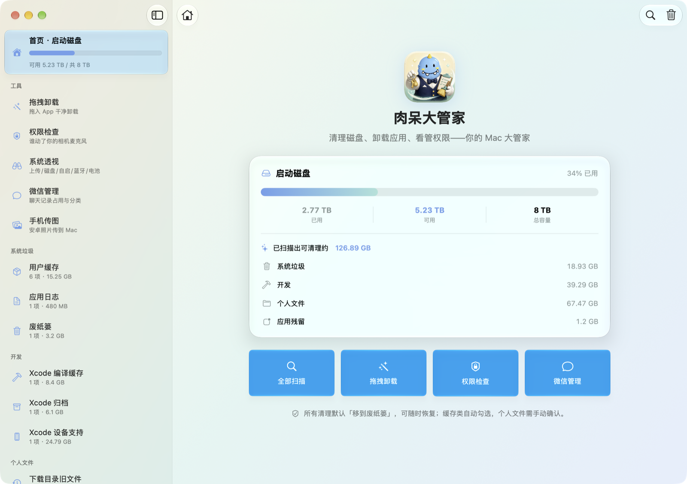
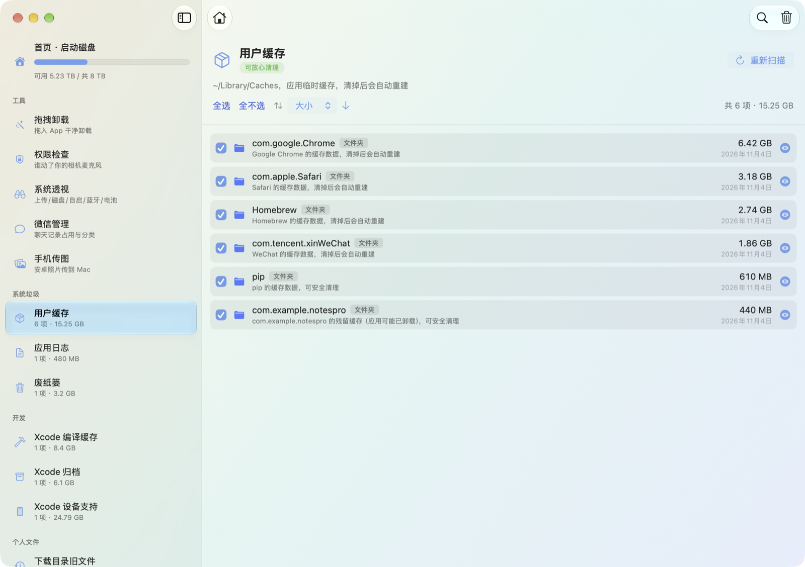
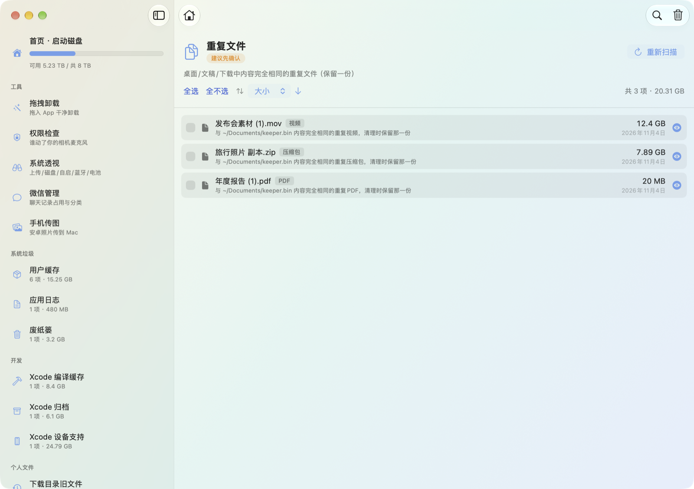
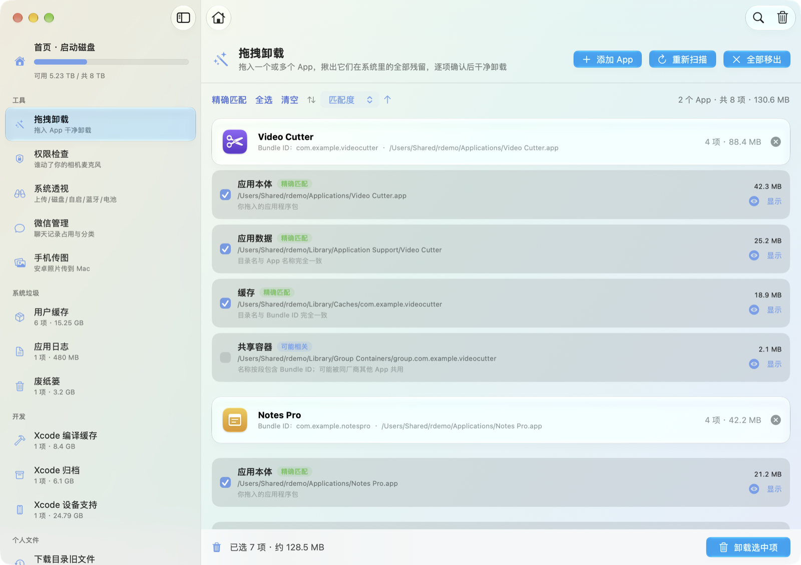
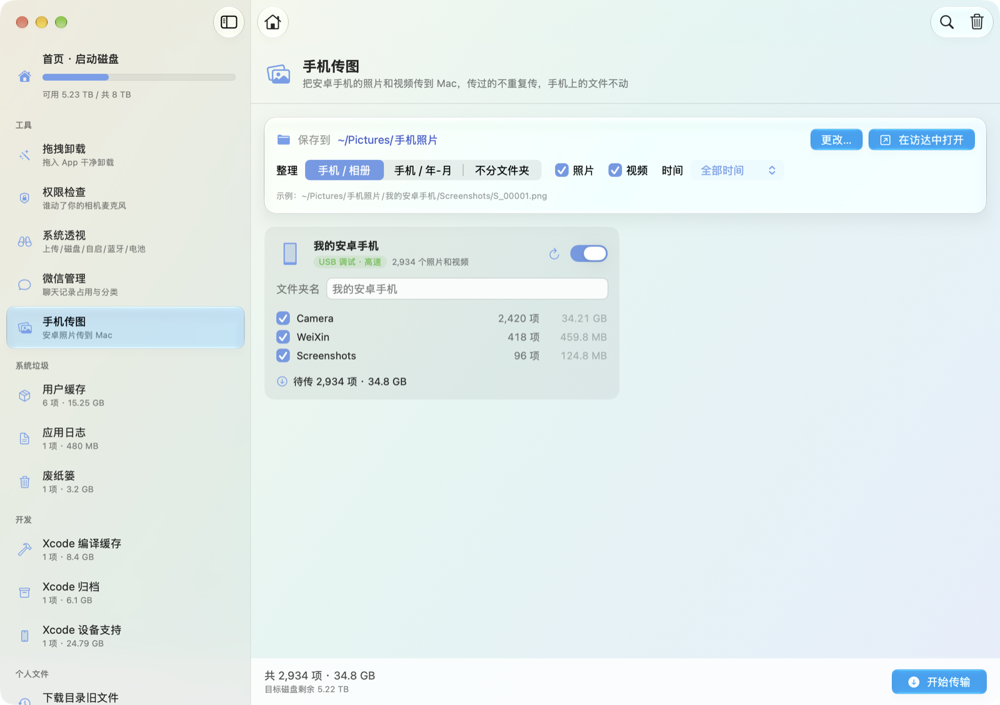
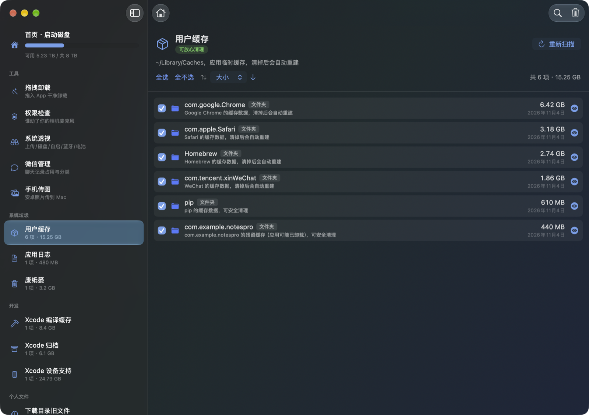

<p align="center"></p>

<h1 align="center">肉呆大管家</h1>

<p align="center">原生 macOS 系统管家：清理磁盘，连同残留卸载 App，把安卓手机的照片传到 Mac，查看每个 App 拿到的权限和后台活动。</p>

<p align="center"><b><a href="https://github.com/rddmwmddr/roudai-guanjia/releases/latest/download/RouDaiGuanJia.dmg">下载最新版（.dmg）</a></b> · <a href="https://ahuamiao.com/sites/other/roudai-tools.html">官网和国内下载</a></p>

<p align="center">macOS 13 及以上 · Apple 芯片和 Intel 通用 · 已通过 Apple 公证 · 不联网</p>



## 特点

### 磁盘清理

扫描 10 类可清理文件，按风险分级勾选。

**特点**

- 用户缓存、应用日志、Xcode 编译缓存、设备支持文件扫描后默认勾选。Xcode 归档、下载旧文件、大文件、重复文件、卸载残留默认不勾选，由你逐项确认。
- 清理调用系统废纸篓接口，文件可以在访达里「放回」。「废纸篓」分类例外，它的清理是永久删除，确认弹窗会写明数量。
- 每个条目标注类型和来源。`com.google.Chrome` 显示为「Google Chrome 的缓存数据」，`MyApp-abc…` 显示为「Xcode 工程 MyApp 的编译中间产物」。
- 同一个文件出现在多个分类时按一个文件计算，总量不重复。

**好处**

比如做 iOS 开发的 Mac，设备支持文件和编译缓存能占几十 GB。扫描后勾选清理，下次连接真机和编译时 Xcode 重新生成。



| 分类 | 位置 | 默认 |
|---|---|---|
| 用户缓存 | `~/Library/Caches` | 勾选 |
| 应用日志 | `~/Library/Logs` | 勾选 |
| Xcode 编译缓存 | `~/Library/Developer/Xcode/DerivedData` | 勾选 |
| Xcode 设备支持 | `~/Library/Developer/Xcode/*DeviceSupport` | 勾选 |
| Xcode 归档 | `~/Library/Developer/Xcode/Archives` | 不勾选 |
| 废纸篓 | `~/.Trash`（永久删除） | 不勾选 |
| 下载目录旧文件 | `~/Downloads` 中 90 天没有动静的项目 | 不勾选 |
| 大文件 | 桌面、文稿、下载、影片、音乐、图片中大于 200 MB 的文件 | 不勾选 |
| 重复文件 | 桌面、文稿、下载中内容相同的文件 | 不勾选 |
| 卸载残留 | `~/Library` 中已卸载 App 留下的文件 | 不勾选 |

### 重复文件

按内容找出桌面、文稿、下载里相同的文件，每组留一份。

**特点**

- 分三层比对：体积相同，文件头尾各 64 KB 的指纹相同，全文 SHA-256 相同。读取出错的文件不参与比对。
- 硬链接不算重复。iCloud 上未下载的占位文件不读取，不会触发下载。
- 保留的那份优先选桌面和文稿里、文件名短的。列表写明每个副本对应保留哪一份。
- 保留的那份被勾选或者不在磁盘上时，副本不动，不会一份不剩。

**好处**

比如下载目录里的「年度报告 (1).pdf」和文稿里的「年度报告.pdf」内容相同，清理后留下文稿里那份。



### 拖拽卸载

把一个或多个 App 拖进窗口，列出它们在 `~/Library`、`/Library` 和安装收据里留下的文件。

**特点**

- 可以一次拖入多个 App，也可以随时往列表里加。文件按 App 分组，两个 App 共用的路径只算一次。
- 按 Bundle ID 和 App 名称匹配，分「精确匹配」「可能相关」「高风险」三级。每一行写明匹配依据。
- 系统级文件和高风险项默认不勾选。`Electron`、`Python` 这类通用名字的目录算「可能相关」，默认不勾选。
- 卸载前有两步确认，第二步要输入「确认」。需要管理员权限的项目合并成一次授权。
- 系统自带的 App 和只读磁盘映像里的 App 不能卸载，界面会说明原因。

**好处**

比如一次卸载三个不再用的剪辑软件，它们留在 Application Support 的素材缓存和后台启动项会按软件分组列出来，确认后一起移走。



### 卸载残留

比对已安装 App 清单，找出 `~/Library` 里没有主人的文件。

**特点**

- 已安装清单来自系统的 `lsregister`，拿不到清单时如实提示，不做判断。
- 判断对象限定为 3 段以上的反向域名，比如 `com.foo.bar`。系统组件、更新器、崩溃统计 SDK、已安装 App 的子组件和同厂商的数据不会被标记。
- 结果默认不勾选，逐项可以在访达里查看。

**好处**

比如两年前卸载的 App 留下的偏好设置和缓存，不用去 `~/Library` 里一个个翻。

### 权限检查

以只读方式读取系统隐私数据库 TCC.db，列出每个 App 拿到的权限。

**特点**

- 摄像头、麦克风、屏幕录制、完全磁盘访问、辅助功能、输入监控等高敏感权限标为橙色，这些 App 排在前面。
- 可以按敏感程度、权限数量、名称排序。

**好处**

比如一个长期不用的 App 握着屏幕录制权限，在这里能看到，然后去系统设置关掉。

### 系统透视

查看网络上传、磁盘读写、开机自启、蓝牙和电池。全部只读。

**特点**

- 网络上传和磁盘读写按 App 汇总，Helper 进程归到主 App。上传超过 100 MB、读取超过 5 GB 标为橙色。
- 磁盘读写统计当前用户的进程，其他用户和系统守护进程的数据 macOS 不开放。
- 开机自启列出第三方的 LaunchAgents 和 LaunchDaemons。
- 电池健康度和「系统设置 › 电池」是同一个口径，附循环次数和容量。

**好处**

比如风扇一直在转，打开磁盘读写，能看到哪个进程在你没操作的时候读了几十 GB。

### 微信管理

统计微信数据占用，按图片、视频、文档、音频、其他分类。

**特点**

- 支持微信 4.x 的 `xwechat_files` 和旧版的数据目录。
- 每类列出最大的 1000 个文件，可以排序、预览、在访达里定位。
- 全程只读，不删除聊天数据。附件和消息数据库相互依赖，清理请用微信自带的存储空间管理。

**好处**

比如想知道微信占的空间里视频有多少、最大的文件是哪些，再决定要不要在微信里清理。

### 手机传图

把安卓手机的照片和视频传到 Mac 指定的文件夹，手机上的文件不动。

**特点**

- 两种连接方式：手机选「文件传输」走 MTP，不用装任何东西；开启 USB 调试并安装 adb 后走 adb，速度更快。同一台手机两种都开时用 adb。
- 只读 DCIM、Pictures、Movies 里的照片和视频，跳过隐藏目录，可以按相册、时间、照片或视频筛选。
- 同名同大小的文件算传过，不重复传。同名不同大小的文件改名保存，不覆盖已有文件。
- 照片的文件日期写成拍摄时间，放进访达按日期排序时顺序正确。
- 文件夹按「手机 / 相册」「手机 / 年-月」或不分文件夹整理。多台手机可以一起传。
- 通过无线调试连接的手机默认不传，要手动打开它的开关。
- 只在打开这一页时连接手机。离开后如果还在传，侧边栏显示进度，传完断开。中途退出 App 时，没传完的文件会被清掉。

**好处**

比如拍了一天的照片，插上线点一次「开始传输」，第二天接着拍，再传时只传新拍的。



### 深色模式和液态玻璃

在 macOS 26 及以上使用液态玻璃，旧系统回退到系统材质。深色和浅色跟随系统。



## 下载和安装

1. 下载 [RouDaiGuanJia.dmg](https://github.com/rddmwmddr/roudai-guanjia/releases/latest/download/RouDaiGuanJia.dmg)。历史版本在 [Releases](https://github.com/rddmwmddr/roudai-guanjia/releases)。
2. 双击打开，把「肉呆大管家」拖到「Applications」。
3. 从「应用程序」打开。系统询问是否打开从互联网下载的 App 时，点「打开」。
4. 授予完全磁盘访问权限：打开「系统设置 › 隐私与安全性 › 完全磁盘访问权限」，打开肉呆大管家的开关，然后退出并重新打开 App。

| 功能 | 完全磁盘访问权限 |
|---|---|
| 废纸篓、权限检查、微信管理 | 必须 |
| 用户缓存、应用日志、Xcode、卸载残留 | 不必须，授权后结果更完整 |
| 下载旧文件、大文件、重复文件 | 不必须，首次扫描时系统会询问桌面、文稿、下载的访问权限 |
| 拖拽卸载、系统透视 | 不必须 |
| 手机传图 | 不必须，用文件传输模式时系统会询问相机权限，点「允许」 |

## 使用教程

### 清理磁盘

1. 点首页或右上角的「全部扫描」。
2. 在侧边栏查看每一类的数量和体积，点开一类查看明细。
3. 勾选要清理的项目。点一行切换勾选；双击在访达里定位；点眼睛图标预览；右键可以拷贝路径。
4. 点右上角的垃圾桶按钮，在弹窗里确认。
5. 看结果弹窗。移到废纸篓的文件要等清空废纸篓才腾出空间。要马上腾出空间，打开「废纸篓」分类，勾选后清理，或者在访达里清空废纸篓。

### 卸载 App

1. 点侧边栏的「拖拽卸载」。
2. 把一个或多个 App 拖进窗口，或者点「选择 App…」，在选择框里按住 ⌘ 多选。要继续添加，点「添加 App」或者接着拖；不想卸载某个 App，点它右边的 × 移出列表。
3. 逐行核对列表。顶部的「精确匹配」「全选」「清空」可以批量调整勾选。
4. 点「卸载选中项」，点「继续」，输入「确认」后点「确认移到废纸篓」。
5. App 在运行时，按提示退出它们。列表里有系统级项目时，按提示输入一次管理员密码。

要恢复时，到废纸篓里把文件「放回」。经管理员权限移动的项目不支持「放回」，要手动移回原位置。

### 把手机照片传到 Mac

1. 用 USB 线连接手机并解锁，在手机通知栏把 USB 用途改成「文件传输」。
2. 点侧边栏的「手机传图」。系统询问相机权限时点「允许」，这个权限用来读取手机相册。
3. 点「更改…」选择保存的文件夹，在下面选整理方式、照片或视频、时间范围。
4. 在手机卡片里取消不想传的相册。
5. 点右下角的「开始传输」。

想传得更快：在手机开发者选项里打开「USB 调试」，并在 Mac 上安装 [Android Platform Tools](https://developer.android.com/tools/releases/platform-tools)（放到 `~/platform-tools/` 或用 Homebrew 安装），手机弹窗询问时点「允许」。

### 查看权限

点侧边栏的「权限检查」，点「开始扫描」。要收回某个权限，到「系统设置 › 隐私与安全性」里关闭。

### 查看后台活动和电池

点侧边栏的「系统透视」，在顶部切换网络上传、磁盘读写、开机自启、蓝牙、电池。网络和磁盘的数字是进程启动以来的累计值，点「刷新」重新读取。

### 查看微信占用

点侧边栏的「微信管理」，点「开始扫描」。点一个分类查看文件，或者点「全部文件」按大小、名称、日期、分类排序。

## 常见问题

**清理后可用空间没有变化？**
文件在废纸篓里，占用的空间没有释放。清空废纸篓后腾出来。

**清错了怎么办？**
打开访达的废纸篓，右键文件，选「放回」。「废纸篓」分类里永久删除的文件无法恢复。

**清理缓存会丢数据吗？**
缓存是 App 可以重新生成的临时文件，清理后 App 下次打开时可能变慢。清理前退出对应的 App。少数 App 把登录状态存在缓存里，清理后要重新登录。

**废纸篓显示需要权限，我授权过了？**
完全磁盘访问权限要重新打开 App 后生效。

**会上传我的数据吗？**
不会。App 没有联网代码，所有扫描在本机完成。

## 测试情况

这一版在 macOS 27（Apple 芯片）上测试。Intel 机型和 macOS 13—25 编译通过，没有上机测试。手机传图的 adb 通道用真机传过，文件传输（MTP）通道这一版还没有真机验证。遇到问题请提 [Issue](https://github.com/rddmwmddr/roudai-guanjia/issues)。

## 从源码构建

需要 Xcode 26 及以上。用 Xcode 打开 `TidyPaw.xcodeproj`，选 `TidyPaw` scheme，按 ⌘R 运行。

```sh
./Tests/run.sh    # 回归测试，在临时的假 Home 里运行，不碰真实文件

# 打发布版（签名、公证、DMG）
SIGN_ID="Developer ID Application: 名字 (TEAMID)" TEAM=TEAMID NOTARY_PROFILE=钥匙串配置名 tools/build_release.sh
```

```
TidyPaw/
├── PathSafety.swift         # 路径保护：删除前的最后一道闸
├── FileScanner.swift        # 体积、旧文件、大文件、重复文件
├── FileClassifier.swift     # 类型识别和来源说明
├── LeftoverScanner.swift    # 卸载残留检测
├── ScanEngine.swift         # 协调扫描、跨分类去重、清理
├── UninstallScanner.swift   # 扫描某个 App 的全部残留
├── UninstallEngine.swift    # 卸载流程和管理员移动
├── PermissionsScanner.swift # 只读 TCC 数据库
├── PrivacyScanners.swift    # 网络、磁盘读写、自启、蓝牙、电池
├── WeChatScanner.swift      # 微信数据统计
├── PhoneTransfer*.swift     # 手机传图：adb 和 MTP 两种通道、传输计划
├── SystemCommand.swift      # 跑系统命令（带超时）
└── *View.swift              # 界面
Tests/                       # 回归测试
tools/build_release.sh       # 发布脚本
```
